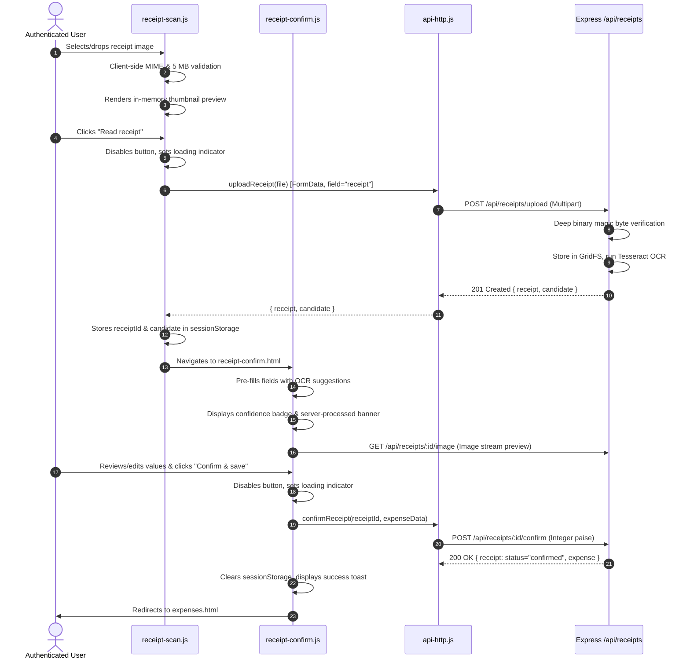

# SplitStack — Phase P13 Technical Audit Report
**Review 3: Frontend API Integration**
**Date:** 2026-10-17  
**Branch:** `refurbish`  
**Starting Commit:** `eef27b7 Review 3: receipt upload and server-side OCR`  

---

## 1. Executive Summary & Objective

Phase **P13** integrates SplitStack's frontend data layer with the Review 3 Node.js/Express REST API (`/api`), enabling all UI pages and components to communicate seamlessly with backend services, transport secure authentication credentials, upload multipart receipts for server-side OCR, and preserve all established domain contracts without silent fallback or data loss.

### Scope & Constraints Preserved:
- **Phase P13 Only:** Focuses exclusively on client API integration, session management, receipt pipeline integration, and dual-mode dispatching. Does not start P14 (seeding/CI) or P15 (deployment).
- **Legacy Preservation:** All legacy Flask application files (`app.py`, `config.py`, `Procfile`, `requirements.txt`, `modules/`, `templates/`, `static/`, `database/`, `ml/`, and legacy tests) remain completely preserved and unedited.
- **Audit Evidence Integrity:** All existing audit reports, inventories, diagrams, and PDFs under `docs/audit/` remain intact and preserved.
- **Local Git Operation:** All changes are local to the `refurbish` branch. No commits are pushed to any remote.
- **Backwards Compatibility:** 100% compatibility with all 176 existing client unit and domain tests.

---

## 2. Frontend Data Layer Architecture

### 2.1 Centralized HTTP REST Client (`client/js/data/api-http.js`)
To eliminate ad-hoc, scattered `fetch()` calls across UI components, `client/js/data/api-http.js` provides a centralized dispatcher:
- **Base URL Management:** Configurable via `setApiBaseUrl(url)` or `window.__SPLITSTACK_API_BASE_URL__` (defaults to `/api`).
- **Query Parameter Serialization:** Automatically serializes structured query objects into URL search params, safely omitting empty strings, null, and undefined values.
- **Header Normalization:** Enforces `Accept: application/json` and `Content-Type: application/json` for JSON requests.
- **Multipart Upload Handling:** Automatically omits `Content-Type` for `FormData` payloads, allowing the runtime to set the exact multipart boundary header.
- **Credential Transport:** Automatically includes `credentials: 'include'` on all requests to transport HttpOnly authentication cookies.
- **In-Memory Token Transport:** Manages Bearer tokens in memory and tab-scoped `sessionStorage`, appending `Authorization: Bearer <token>` when set.
- **Unified Error Mapping:** Automatically parses structured backend error responses (`{ message }`, `{ error }`, and `{ fields: { [field]: message } }`) into strongly typed `ApiError { message, field, status }` instances.
- **Offline & Network Error Detection:** Intercepts fetch rejections and `navigator.onLine === false` states, converting them into structured `ApiError` instances with status code `0`.

### 2.2 Dual-Mode Dispatcher (`client/js/data/api.js`)
`client/js/data/api.js` serves as the primary façade for all UI pages, dynamically delegating calls between the HTTP client (`api-http.js`) and the local storage client (`store.js`):
- **Auto-Detection:** 
  - In a real browser running on `http:` or `https:`, `getApiMode()` defaults to `'api'`.
  - In Node.js unit test runners (`process.versions.node`), `getApiMode()` defaults to `'local'`.
  - Users and developers can explicitly toggle operating mode via `setApiMode('api' | 'local')` or `localStorage.setItem('splitstack_mode', mode)`.
- **Zero Silent Fallback Policy:** When in `'api'` mode, server errors (400, 401, 403, 404, 409, 500) or network failures immediately throw an `ApiError` to the calling form or UI component. The system **never** silently writes data to `localStorage` after a server failure or falsely implies that data was saved to the server.

---

## 3. Authentication & Session Integration

| Requirement | Implementation in SplitStack | Security Guarantees |
|---|---|---|
| **Credential Transport** | `credentials: 'include'` on all `api-http.js` requests | Transports server-managed HttpOnly session cookies across origins. |
| **Token Storage** | In-memory `let inMemoryToken` synced to tab `sessionStorage` | **Never** stored in persistent `localStorage`. Immune to multi-tab leakage and persistence after tab close. |
| **Password Security** | Passwords sent only over POST body directly to `/auth/login` and `/auth/register` | Passwords, hashes, and salts are never cached in memory or browser storage. |
| **Session Restoration** | `httpCurrentUser()` calls `GET /api/auth/me` on app initialization | Verifies session directly against the backend principal rather than trusting client-supplied user IDs. |
| **401 Invalidation** | Centralized in `request()` | On any 401 Unauthorized response, `setAuthToken(null)` immediately clears in-memory credentials. |
| **Logout** | `httpLogout()` calls `POST /api/auth/logout` | Clears server-side HttpOnly cookie and purges client in-memory tokens. |

---

## 4. Resource Endpoints Integration

All resources connect to the exact endpoints implemented by the Review 3 Express backend in Step P11 and P12:

### 4.1 Expenses & Income (`/api/expenses`, `/api/income`)
- **Integer Paise Representation:** All monetary amounts are strictly maintained and submitted as integer paise (1 Rupee = 100 paise).
- **Filtering & Pagination:** Fully synchronized query parameters: `page`, `limit`, `search`, `categoryId`, `paymentMethod`, `startDate`, `endDate`, `minPaise`, `maxPaise`, and `sort`.
- **Response Normalization:** MongoDB `_id` and category references are normalized to client contract format (`id`, `categoryId`).

### 4.2 Categories & Budgets (`/api/categories`, `/api/budgets`)
- **System vs Custom Categories:** Supports system-default categories (`user: null`) and user custom categories.
- **Budget Tracking:** `httpListBudgets(month, year)` maps category budget limits and spent percentages with integer paise limits.

### 4.3 Groups, Members & Debt Simplification (`/api/groups`)
- **Collaborative Groups:** `GET /groups`, `POST /groups`, `GET /groups/:id`, `POST /groups/:id/members`, `DELETE /groups/:id/members/:userId`, and `POST /groups/:id/leave`.
- **Shared Expenses:** `GET /groups/:id/expenses` and `POST /groups/:id/expenses` mapping participant shares (`sharePaise`) to enforce zero-sum balance conservation.
- **Deletion Support:** `DELETE /groups/:id/expenses/:expenseId` and `DELETE /groups/:id/settlements/:settlementId` accept group and item context cleanly.
- **Greedy Debt Simplification:** `GET /groups/:id/balances` and `GET /groups/:id/suggested-settlements` return optimized minimal-cash-flow payment plans.

### 4.4 Shopping Lists & Checklist Items (`/api/shopping`)
- **List CRUD:** `GET /shopping`, `POST /shopping`, `GET /shopping/:id`, `PATCH /shopping/:id`, `DELETE /shopping/:id`.
- **Interactive Checklists:** Item status toggling via `PATCH /shopping/:id/items/:itemId/toggle` and updates via `PATCH /shopping/:id/items/:itemId`.
- **Expense Conversion:** Duplicate-protected conversion via `POST /shopping/:id/convert-expense`.

### 4.5 Analytics, Forecast, Insights & Search
- **Monthly Summary:** `GET /api/analytics/monthly?month=...&year=...&monthsBack=6`.
- **Category Breakdown:** `GET /api/analytics/categories?month=...&year=...&type=expense`.
- **Velocity Spending Forecast:** `GET /api/analytics/forecast` with compatibility aliases (`totalSoFar`, `projectedSpend`, `monthlyBudget`).
- **Smart Insights & Notifications:** `GET /api/analytics/insights`, `GET /api/notifications`, `PATCH /api/notifications/:id/read`, `POST /api/notifications/mark-all-read`.
- **Global Cross-Collection Search:** `GET /api/search?q=...` searching expenses, income, groups, and shopping lists simultaneously.

---

## 5. Receipt Upload & Server-Side OCR Workflow

The receipt scanning and review experience (`receipt-scan.js` and `receipt-confirm.js`) is connected end-to-end to the P12 backend contract:

### Safety & Robustness Guarantees:
- **No Manual Boundary Header:** Uses `FormData` directly without manual `Content-Type` headers.
- **Untrusted Suggestions:** All OCR extracted data is presented as editable suggestions with confidence indicators.
- **Explicit User Confirmation:** No expense is created until the user explicitly clicks "Confirm & save".
- **Duplicate Protection:** Button loading prevents rapid double-clicks. If an already-confirmed receipt is submitted again, the server 409 Conflict response is caught and displayed cleanly with an informative toast message.
- **Failure Recovery:** If upload or OCR fails, the submit button is re-enabled, a descriptive error message is shown, and the user can safely retry without losing local form state.

---

## 6. Local Data Migration & Recovery

To prevent accidental data loss for users with existing Review 2 browser-local data:
1. **Zero Discard Policy:** Local data in `localStorage` under `splitstack:v1` is never automatically discarded, overwritten, or wiped upon connecting to the server.
2. **Safe Snapshot Utility (`exportLocalData`):** Reads and returns a full JSON snapshot of `localStorage` without mutating any records.
3. **User-Initiated Migration (`importLocalDataToServer`):**
   - Strictly requires an active authenticated session (`httpCurrentUser()`).
   - Validates each local custom category, expense, income record, group, and shopping list.
   - Posts records sequentially to server REST endpoints.
   - Returns a structured summary `{ categoriesCount, expensesCount, incomeCount, groupsCount, shoppingCount }`.
   - Never runs automatically in the background without explicit user instruction.

---

## 7. Verification & Test Suite Execution

### 7.1 Automated Client Test Suite (`npm run test:client`)
Includes the new comprehensive test suite `tests/client/api-http.test.mjs` (25 tests) alongside all existing Review 2 client tests:
- **Command:** `npm run test:client`
- **Results:**
  - **Total Tests:** 201 tests across 59 suites
  - **Passed:** 201
  - **Failed:** 0
  - **Duration:** ~520 ms
- **Coverage in `api-http.test.mjs`:**
  - Base URL configuration and custom prefix setting
  - Query parameter serialization and empty parameter pruning
  - Header construction for JSON and multipart payloads
  - 204 No Content empty response parsing
  - Authorization Bearer token attachment and 401 session clearing
  - `httpCurrentUser()` restoration and null fallback on unauthenticated session
  - `httpLogout()` server transport and local memory purge
  - Error mapping for structured validation errors and network connection failures
  - 409 Conflict handling for duplicate resources
  - Integer-paise preservation in expense, income, and shared expense payloads
  - Multipart receipt upload without manual Content-Type header
  - Receipt confirmation with linked expense generation
  - Prevention of silent fallback to `localStorage` when in `'api'` mode
  - Authentication guard on data migration helper

### 7.2 Automated Server Test Suite (`npm run test:server`)
- **Command:** `npm run test:server`
- **Results:**
  - **Total Tests:** 123 tests across 43 suites
  - **Passed:** 123
  - **Failed:** 0
  - **Duration:** ~4.5 s
- **Coverage:**
  - Health checks, error handling, static routing (Step P9)
  - Mongoose data models and validation (Step P10)
  - Authentication, password hashing, and REST API resources (Step P11)
  - Multipart upload, binary magic byte verification, OCR pipeline, and GridFS storage (Step P12)

### 7.3 HTML Validation (`npm run lint:html`)
- **Command:** `npm run lint:html`
- **Results:** All 25 HTML pages validate with 0 errors and 0 warnings.

### 7.4 Live Database & Integration Testing Note
- Unit tests in `tests/client/api-http.test.mjs` use deterministic mocked `fetch` responses to verify request construction, headers, payloads, and error mappings in isolation.
- Server test suites run against the Express application with in-memory fallbacks when an external MongoDB daemon is not running. Live database operations require a reachable MongoDB instance (configured via `MONGODB_URI`).

---

## 8. Git Status & Audit Compliance

- **Current Branch:** `refurbish`
- **Expected Starting Commit:** `eef27b7 Review 3: receipt upload and server-side OCR`
- **Modified Tracked Files:**
  - `client/README.md`
  - `client/js/data/api.js`
  - `client/js/pages/group-detail.js`
  - `client/js/pages/receipt-confirm.js`
  - `client/js/pages/receipt-scan.js`
  - `client/js/pages/settlements.js`
  - `docs/prompt_log.json`
- **Added Files:**
  - `client/js/data/api-http.js`
  - `tests/client/api-http.test.mjs`
  - `docs/audit/P13_FRONTEND_API_INTEGRATION_AUDIT.md`
- **Preserved Untracked Files:** All legacy Flask files and existing audit evidence in `docs/audit/` remain intact.
- **Commit Message:** `Review 3: frontend API integration`
- **Push Status:** Not pushed to any remote.
